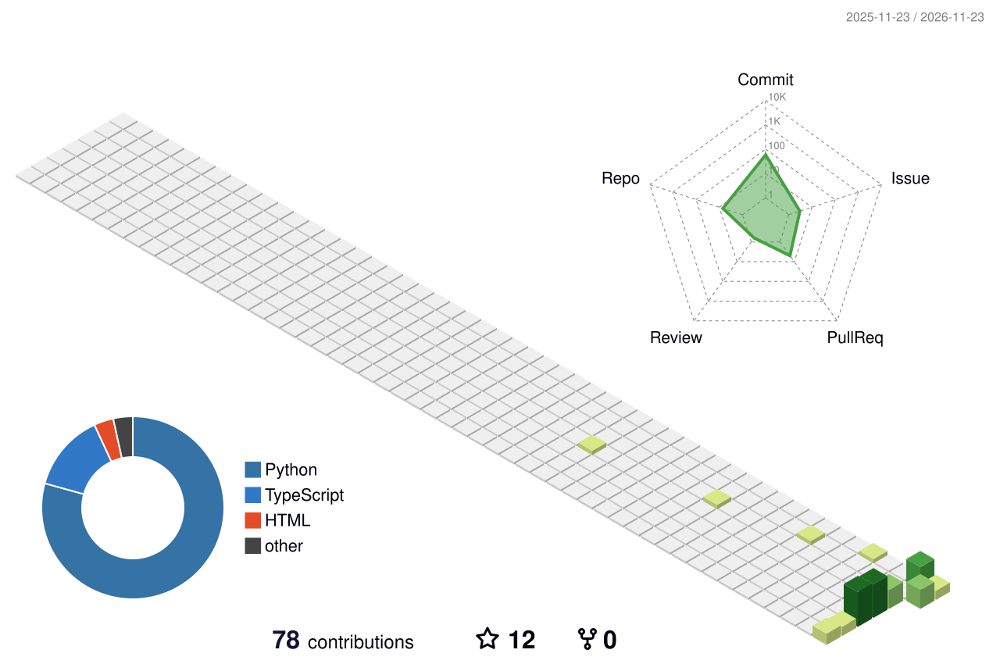

<div align="center">

  <!-- WhatsApp Chat Animation UI -->
  

  <br/><br/>

  <!-- 3D Minted Metallic Coin Badges -->
  <p align="center">
    <a href="https://www.linkedin.com/in/ishan-gupta-976192419" target="_blank" title="Connect on LinkedIn"></a>&nbsp;&nbsp;&nbsp;&nbsp;<a href="mailto:ishan14122007@gmail.com" title="Send Email"></a>&nbsp;&nbsp;&nbsp;&nbsp;<a href="https://github.com/ishangupta1412?tab=repositories" title="Explore Verified Repositories"></a>&nbsp;&nbsp;&nbsp;&nbsp;<a href="https://x.com/ishangupta1412" title="Follow on X"></a>
  </p>

  <!-- Live Verified Profile Metrics Badges -->
  <p align="center">
    &nbsp;
    &nbsp;
    &nbsp;
    
  </p>

</div>

<br/>

---

### 3D Contribution Landscape

<div align="center">
  <picture>
    <source media="(prefers-color-scheme: dark)" srcset="./profile-3d-contrib/profile-night-rainbow.svg" />
    
  </picture>
  <sub>Real-time 3D contribution matrix · Auto-compiled from GitHub API</sub>
</div>

---

### Galaga Contribution Arena

<div align="center">
  <picture>
    <source media="(prefers-color-scheme: dark)" srcset="https://raw.githubusercontent.com/ishangupta1412/ishangupta1412/output/galaga-contribution-graph-dark.svg?v=2" />
    
  </picture>
  <sub>Live contribution grid · Galaga fighters locked on · Updates daily at 00:00 UTC</sub>
</div>

<br/>

---

### Focus & Philosophy

I build resilient, mathematically grounded software. My work centers on high-complexity engineering challenges: detecting distributed adversary behavior in enterprise authentication telemetry, deploying multimodal AI for statutory compliance, and engineering accessible, high-performance web systems.

- **Enterprise Defense**: Graph algorithms for low-and-slow attack correlation and tamper-evident audit ledgers.
- **Multimodal AI & RAG**: Semantic vector retrieval and vision forensics grounded in statutory standards.
- **Modern Web Architecture**: Next.js (App Router), TypeScript, React 19, and accessible design systems (IS 17802 / WCAG 2.1 AA).

---

### Flagship Systems

<table>
  <tr>
    <td width="50%" valign="top">
      <h3>🛡️ Quorum</h3>
      <p><em>Enterprise SOC detection layer countering NOBELIUM distributed password sprays. Built for <strong>Microsoft Innovate 2026</strong>.</em></p>
      <p>
        <a href="https://quorum-soc.vercel.app/"><strong>Live Production</strong></a> &nbsp;|&nbsp; 
        <a href="https://github.com/ishangupta1412/Quorum"><strong>Source Code</strong></a> &nbsp;|&nbsp;
        <a href="https://github.com/ishangupta1412/Quorum/stargazers"></a>
      </p>
      <ul>
        <li>Correlates distributed VPN auth telemetry via <strong>Bipartite Graph Union-Find</strong> clustering.</li>
        <li>Implements <strong>SHA-256 tamper-evident ledgers</strong> with multi-family consensus arithmetic.</li>
        <li>Native <strong>Microsoft Sentinel ARM</strong> and STIX 2.1 integration with interactive D3.js visualization.</li>
      </ul>
      <p><sub><code>Next.js 14</code> • <code>TypeScript</code> • <code>D3.js</code> • <code>Sentinel ARM</code> • <code>STIX 2.1</code></sub></p>
    </td>
    <td width="50%" valign="top">
      <h3>🇮🇳 BIS Saathi</h3>
      <p><em>Multimodal regulatory cockpit &amp; technical guidance platform. Built for <strong>Smart India Hackathon 2026 (SIH26107)</strong>.</em></p>
      <p>
        <a href="https://bis-saathi-nine.vercel.app/"><strong>Live Production</strong></a> &nbsp;|&nbsp; 
        <a href="https://github.com/ishangupta1412/sih26107-bis-saathi"><strong>Source Code</strong></a> &nbsp;|&nbsp;
        <a href="https://github.com/ishangupta1412/sih26107-bis-saathi/stargazers"></a>
      </p>
      <ul>
        <li><strong>Gemini 3.8 Flash Vision</strong> photo forensics for instant packaging compliance verification.</li>
        <li><strong>Supabase pgvector RAG</strong> grounding answers across 20,000+ Indian Standards (IS codes).</li>
        <li>Web Speech API supporting <strong>22 Scheduled Indic languages</strong>, compliant with GIGW 3.0 &amp; IS 17802:2021.</li>
      </ul>
      <p><sub><code>Next.js 16</code> • <code>React 19</code> • <code>Gemini Flash</code> • <code>Supabase pgvector</code> • <code>Tailwind v4</code></sub></p>
    </td>
  </tr>
</table>

---

### Core Stack & Technologies

<p align="center">
  
  
  
  
  
  
  
  
  
  
  
</p>

```
Languages     TypeScript, JavaScript (ESNext), Python, PowerShell, SQL
Frontend      Next.js (App Router), React 19, Tailwind CSS, D3.js, Radix UI
Backend & AI  Node.js, FastAPI, Google Gemini API (Multimodal), Supabase pgvector
Systems       Docker, Linux, Git, Microsoft Sentinel, SHA-256 Ledgers
Standards     GIGW 3.0, IS 17802:2021 (W3C WCAG 2.1 AA), DPDP Act 2023
```

---

<div align="center">
  <sub>Engineered with precision. All systems open source under the MIT License.</sub>
</div>
